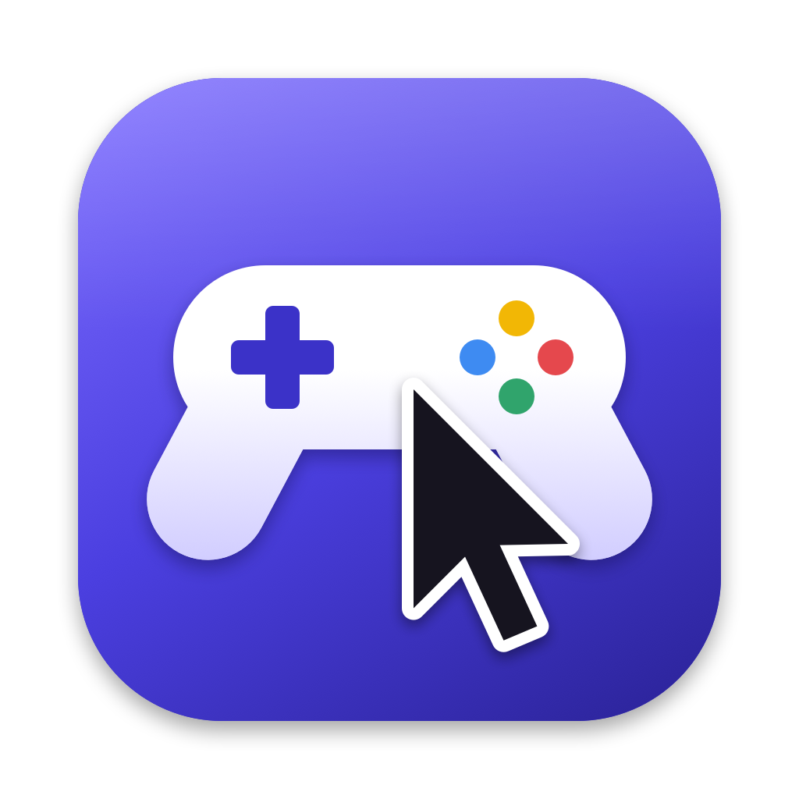

# gc2mouse



把游戏手柄变成 Mac 的鼠标 / 触控板。菜单栏常驻，按键可以通过 JSON 配置文件自定义。

支持 Xbox、PS、8BitDo 等 macOS GameController 能识别的手柄。

## 安装

需要 Xcode 命令行工具（`xcode-select --install`）。

```bash
git clone https://github.com/gq-guo/gc2mouse.git
cd gc2mouse
./build.sh --install
```

App 会被装到个人目录的 `~/Applications/gc2mouse.app`（不是系统的 /Applications）并启动，菜单栏出现手柄图标。

首次运行要授权：系统设置 → 隐私与安全性 → 辅助功能，把 `~/Applications/gc2mouse.app` 拖进列表并打开。授权后无需重启，菜单栏的 ⚠️ 消失即生效。
App 默认用临时签名，**每次重新编译后都要重新授权**，可以用下面「重新编译后不丢授权」一节的方法解决。

## 默认按键

| 按键 | 功能 |
|---|---|
| 左摇杆 | 移动光标（LT 精准 / RT 加速） |
| 右摇杆 | 滚动 |
| X | 单击；快按两下 = 双击；按住 + 左摇杆 = 拖动 |
| 按住 Y（双指） | 左摇杆滚动；轻点 = 右键；十字键 ↑↓ 音量、←→ 上/下一首 |
| 按住 A（三指） | 甩左摇杆：←→ 切换桌面，↑ 调度中心，↓ 应用窗口；轻点 = 查询 |
| 按住 B（四指） | 甩左摇杆：←→ 切换应用，↑ 显示桌面，↓ 应用程序 |
| RB / LB | 右键 / 后退（⌘[） |
| L3 / R3 | 聚焦搜索 / 中键 |
| 十字键 | 方向键（按住连发） |
| Start / Select | 回车 / Esc（松开时触发） |
| Home 或 Select+Start 长按 | 暂停 / 恢复 |

> 8BitDo 等任天堂布局手柄（X 在上、Y 在左）：菜单 → 按键印字 → 任天堂。
> 切换桌面依赖系统快捷键 ⌃← / ⌃→，需在 系统设置 → 键盘 → 快捷键 → 调度中心 中开启。

## 自定义按键

配置文件：`~/.config/gc2mouse/config.json`（菜单 → 编辑按键配置）。旧版 GamepadMouse 的配置会自动迁移过来。

- 保存后约 1 秒自动生效，不用重启。
- 只写想改的部分即可，没写的沿用默认值。完整默认配置见 [config.example.json](config.example.json)。
- 配置有错时菜单栏显示 ⚠️，菜单里会写明哪一项错了，期间继续使用上一份可用配置。
- Select+Start 长按 0.8 秒的暂停开关不受配置影响，配错了也能停下来。

### 例子

```json
{
  "layout": "nintendo",
  "cursorSpeed": 2000,
  "buttons": {
    "LB": "key:cmd+shift+4",
    "RB": "mode:media"
  },
  "modes": {
    "media": {
      "label": "媒体",
      "stick": "none",
      "tap": "media:playPause",
      "buttons": {
        "Up": { "action": "media:volumeUp", "repeat": true },
        "Down": { "action": "media:volumeDown", "repeat": true },
        "Left": "media:previous",
        "Right": "media:next"
      }
    }
  }
}
```

LB 改成截图，按住 RB 进入「媒体」模式：轻点 RB 播放/暂停，按住 RB 时十字键控制音量和切歌。

### 顶层字段

| 字段 | 取值 | 默认 |
|---|---|---|
| `layout` | `xbox` / `nintendo` | `xbox` |
| `cursorSpeed` | 光标最高速度，像素/秒，100–10000 | 1600 |
| `scrollSpeed` | 滚动最高速度，像素/秒，100–10000 | 2200 |
| `deadzone` | 摇杆死区，0–0.9 | 0.15 |
| `invertScroll` | 反转滚动方向 | `false` |
| `leftStick` / `rightStick` | `cursor` / `scroll` / `none` | `cursor` / `scroll` |
| `buttons` | 按键 → 动作 | 见上表 |
| `modes` | 模式定义 | `twoFinger` / `threeFinger` / `fourFinger` |

### 按键名

`A B X Y LB RB LT RT L3 R3 Up Down Left Right Start Select Home`

A/B/X/Y 指手柄上**印的字**，和 `layout` 配合使用。

### 动作

| 动作 | 说明 |
|---|---|
| `leftClick` | 左键，支持双击、按住拖动 |
| `rightClick` / `middleClick` | 右键 / 中键 |
| `key:<组合键>` | 键盘，如 `key:cmd+c`、`key:ctrl+left`、`key:f11` |
| `media:<键>` | `volumeUp` `volumeDown` `mute` `playPause` `next` `previous` `brightnessUp` `brightnessDown` |
| `app:<路径>` | 打开应用，如 `app:/Applications/Safari.app` |
| `appSwitchNext` / `appSwitchPrev` | ⌘Tab 应用切换器 |
| `mode:<模式名>` | 按住进入模式 |
| `precision` / `turbo` | 按住降速 / 加速（扳机按力度） |
| `toggle` | 暂停 / 恢复 |
| `none` | 不做任何事 |

需要按住连发时，把动作写成对象：`{"action": "key:up", "repeat": true}`，只对 `key:` 和 `media:` 有效。

修饰键：`cmd` `ctrl` `alt`/`option` `shift` `fn`。
主键：字母、数字、`return` `escape` `space` `tab` `delete` `forwarddelete` `up` `down` `left` `right` `home` `end` `pageup` `pagedown` `f1`–`f20`、符号 ``- = [ ] ; ' , . / \ ` ``。

### 模式

按住绑定了 `mode:<名字>` 的键时进入该模式：

| 字段 | 说明 |
|---|---|
| `label` | 菜单栏显示的名字 |
| `stick` | 左摇杆用途：`scroll` 滚动、`flick` 甩动触发、`cursor` 移动光标、`none` |
| `up` `down` `left` `right` | `stick` 为 `flick` 时，往各方向甩一下触发的动作 |
| `tap` | 轻点模式键（0.3 秒内松开、没动摇杆）触发的动作 |
| `buttons` | 按键层：模式期间覆盖这些按键的动作 |

与默认模式同名时，整体替换默认模式。

## 调试

```bash
GC2MOUSE_DEBUG=1 ~/Applications/gc2mouse.app/Contents/MacOS/gc2mouse
```

会打印按键按下 / 松开和配置加载情况，可以用来确认按键名对应哪个物理键。

## 限制

- macOS 不允许程序模拟真实的多指触控，「双指 / 三指 / 四指」用滚动事件和系统快捷键实现，没有捏合缩放。
- 依赖辅助功能权限发送鼠标 / 键盘事件。

## 图标

`Icon/draw.swift` 用代码绘制图标，改完运行 `./Icon/make_icns.sh` 重新生成 `Resources/AppIcon.icns`。

## 重新编译后不丢授权

默认是临时签名，每次重新编译都要在「辅助功能」里删掉 gc2mouse 再重新添加。运行一次：

```bash
./scripts/setup_signing.sh
```

会在登录钥匙串里创建本机自签名证书「gc2mouse Local Signing」，之后 `build.sh` 自动用它签名，授权一直有效。第一次签名时系统会弹窗，输入登录密码并点「始终允许」。
